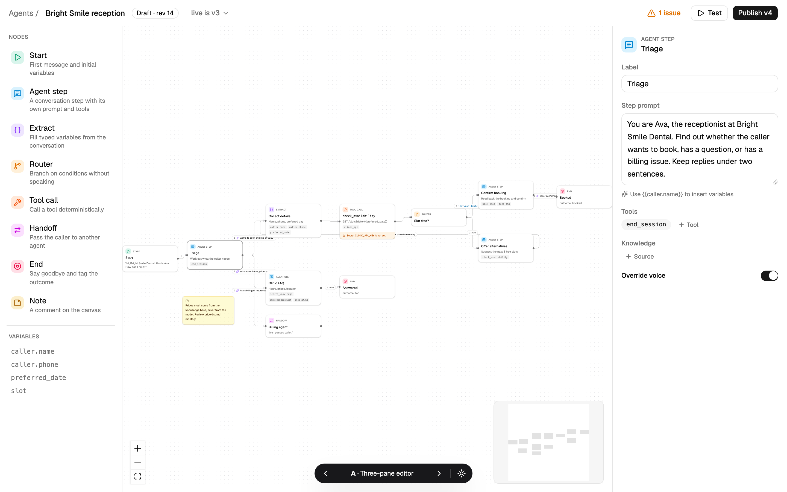
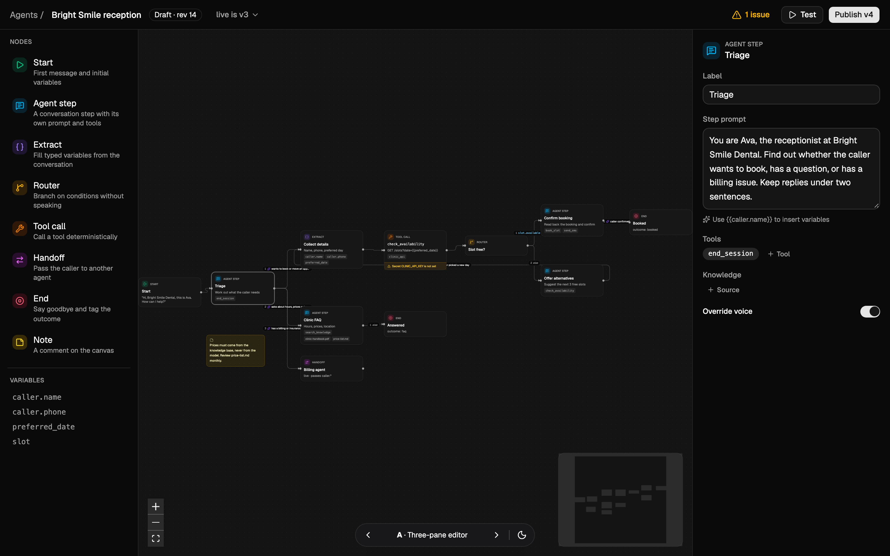
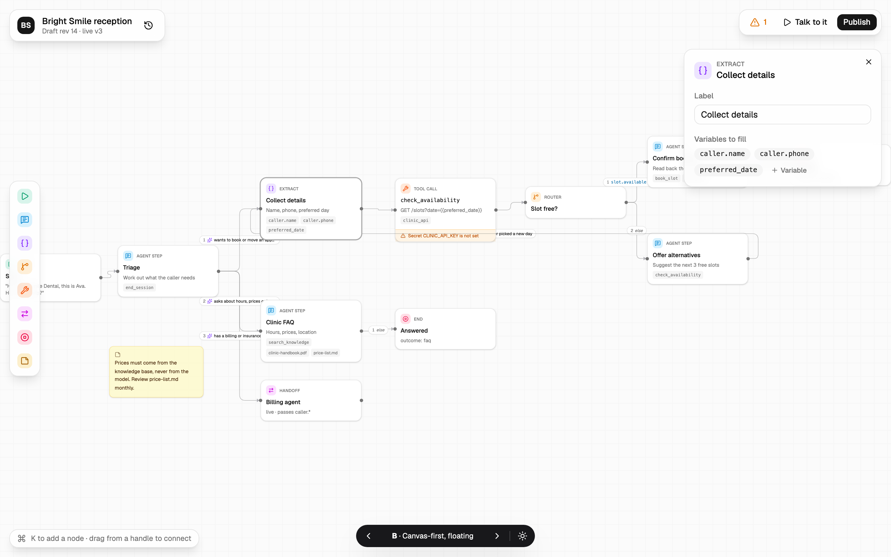
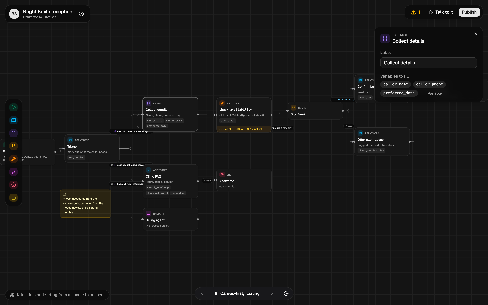
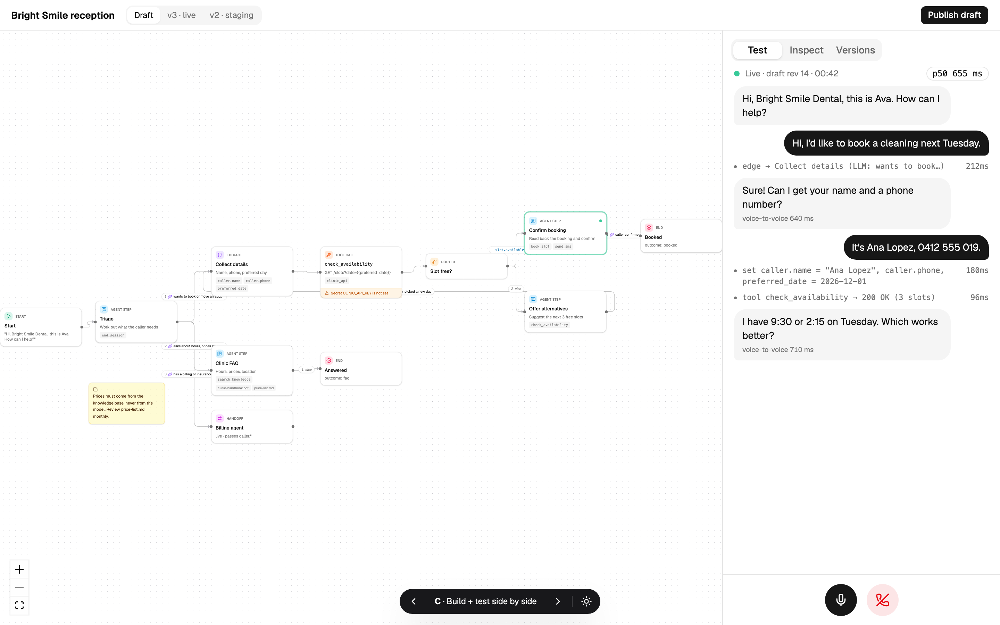
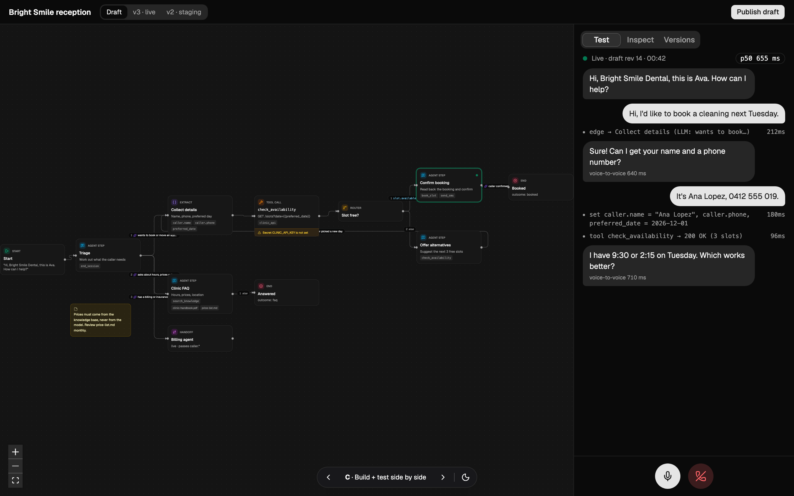
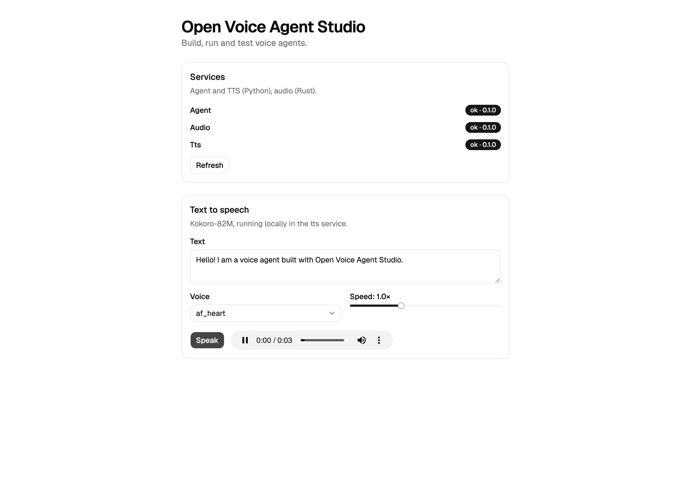

# Builder layout prototype (throwaway)

**Question:** what should the React Flow agent builder look like? Mock data only, no backend.
This branch is never merged; the chosen layout gets rebuilt properly in milestone M1.

Run: `cd frontend && pnpm dev`, then open `/prototype/builder?variant=A` (or B, C).
Switch with the floating bar or the ← → keys; the sun/moon button toggles dark mode.

| Variant | Idea |
| --- | --- |
| A · Three-pane editor | Node palette left, canvas centre, inspector right, top bar with draft, live version, issues, Test, Publish |
| B · Canvas-first, floating | Full-bleed canvas; agent pill, actions, icon palette and inspector all float over it |
| C · Build + test side by side | Canvas plus a tabbed right panel: live test console (active node glows), Inspect, Versions timeline |

## Screenshots

| | Light | Dark |
| --- | --- | --- |
| A |  |  |
| B |  |  |
| C |  |  |

Before (current studio page): 

## Verdict

_Pending: pick a variant, or mix parts of them._
